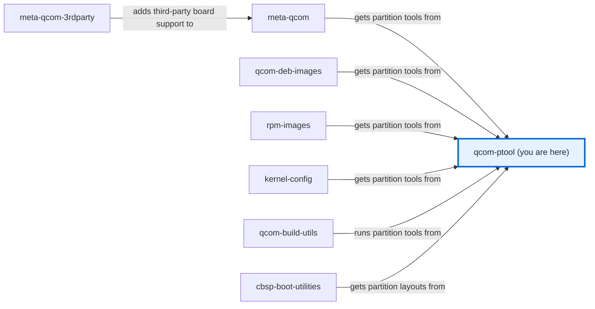

# qcom-ptool

qcom-ptool contains various device partitioning utilities like ptool.py, gen_partitions.py and various sample partition configuration files needed for Qualcomm SoCs. Qualcomm Linux currently supports two reference Linux based OSes (Yocto with [meta-qcom](https://github.com/qualcomm-linux/meta-qcom) and Debian with [qcom-deb-images](https://github.com/qualcomm-linux/qcom-deb-images)) which uses this tool to generate partition table layouts. The partition GUIDs, names and size budgets are picked to support boot flows as follows:

- (preferred) "edk2/UEFI": PBL => XBL => edk2/UEFI => high-level OS (Linux)
- (legacy) "U-Boot/UEFI": PBL => XBL => ABL => U-Boot/UEFI => high-level OS (Linux)

# Installation

The project is packaged as a standard Python distribution and installs a
single `qcom-ptool` command with subcommands for each utility:

```sh
pip install .
```

Once installed, the tool is invoked as:

```sh
qcom-ptool gen_partition -i platforms/<soc>/<variant>/partitions.conf -o partitions.xml
qcom-ptool gen_contents  -p partitions.xml -t contents.xml.in -o contents.xml
qcom-ptool gen_udev_rules -o 55-qcom-raw-partitions-noblkid.rules
qcom-ptool ptool         -x partitions.xml
qcom-ptool msp           -r rawprogram0.xml -d /dev/sdX -p patch0.xml
```

By default, the generator scans all `platforms/*/*/partitions.conf` files.
Repeatable `-i` options can select specific layouts. It skips known filesystem
partition names and emits exact `PARTNAME` rules for the others. Unknown names
retain normal blkid probing. The rules use
`UDEV_DISABLE_PERSISTENT_STORAGE_BLKID_FLAG` on systemd v252 and newer.

Run `qcom-ptool <subcommand> -h` to see the options accepted by each
subcommand.

# Development

## Dependencies

At runtime the tool targets Python 3.8+ and depends on two third-party
libraries, `PyYAML` and `jsonschema`, used to load and validate the YAML
partition source. Both are declared in `pyproject.toml` and pulled in
automatically by `pip install .`.

For development, `make lint` invokes `ruff` and `mypy` and `make unit-test`
runs the `pytest` suite under `tests/unit/`. On Debian/Ubuntu, install
them as follows (ruff is not packaged in apt on all releases/architectures,
so we install it from snap):

```sh
sudo snap install ruff
sudo apt install mypy python3-pytest
```

## Makefile targets

| Target        | Description                                                |
|---------------|------------------------------------------------------------|
| `all`         | Generate partition XML and GPT binaries for all platforms  |
| `lint`        | Run ruff (linter) and mypy (type checker) on the package   |
| `unit-test`   | Run the pytest suite under `tests/unit/`                   |
| `integration` | Build all platforms and verify generated files are present |
| `check`       | Run `lint`, `unit-test`, and `integration`                 |
| `install`     | Install the package (`pip install .`)                      |
| `clean`       | Remove generated XML and binary files from platforms/      |

The Makefile invokes `qcom-ptool` from `PATH`. Install the package (or
`pip install -e .` from the repo root) before running `make all`.

### Quick start

```sh
# install the tool
pip install -e .

# install linters and test runner (Debian/Ubuntu)
sudo snap install ruff
sudo apt install mypy python3-pytest

# run linters and unit tests
make lint
make unit-test

# build all platforms and run tests
make check
```

## Code contributions

See [CONTRIBUTING.md file](CONTRIBUTING.md) for instructions on how to send
code contributions to this project. You can also [report an issue on
GitHub](../../issues).

# Branches

| Branch | Purpose and status | Build from it | Contributions |
| --- | --- | --- | --- |
| `main` | Default and only branch, holding the tool, platform layouts, and tests; last commit on 2026-09-27 ([history](https://github.com/qualcomm-linux/qcom-ptool/commits/main)); no support policy is documented | Yes | See [CONTRIBUTING.md](CONTRIBUTING.md) |

This table lists every current branch. [BRANCHES.md](BRANCHES.md) describes branch
maintenance.

# Documentation

Open [docs/site/index.html](docs/site/index.html) directly in a browser for the
generated site; the [documentation guide](docs/README.md) explains how to rebuild it.

- [Tutorial](docs/source/user/USAGE.md): generate the partition files for one board.
- [Configuration reference](docs/source/user/CONFIGURATION.md): layout formats, build variables, and tool settings.
- [Development setup](docs/source/contributing/DEVELOPMENT.md): install the tools and run the checks.
- [Function reference](docs/source/contributing/README.md#function-reference): generated from the Python and Rust source comments.

# Support

Ask questions and report problems in
[GitHub issues](https://github.com/qualcomm-linux/qcom-ptool/issues). Report
vulnerabilities privately as described in [SECURITY.md](SECURITY.md).

# Maintainer(s)

See [CODEOWNERS](.github/CODEOWNERS).

# License

This project is licensed under the [BSD-3-clause
License](https://spdx.org/licenses/BSD-3-Clause.html). See
[LICENSE](LICENSE) for the full license text.
Notices for the reused documentation files are in [NOTICE.md](NOTICE.md).

# Repository contents

## Folders

- [.github/](.github/) — Holds [CODEOWNERS](.github/CODEOWNERS), the [issue templates](.github/ISSUE_TEMPLATE/), the [pull request template](.github/PULL_REQUEST_TEMPLATE/pr_template.md), the [CI workflows](.github/workflows/), and the documentation scripts [finalise_site.py](.github/finalise_site.py), [check_offline.py](.github/check_offline.py), and [test_reference_coverage.py](.github/test_reference_coverage.py).
- [degpt/](degpt/README.md) — Contains a Rust tool that writes a partition XML from existing GPT images.
- [docs/](docs/README.md) — Contains the documentation source, the generated site, and the build entry point.
- [platforms/](platforms/README.md) — Contains the partition layouts and flashing templates for each board and storage.
- [qcom_ptool/](qcom_ptool/README.md) — Contains the Python package behind the `qcom-ptool` command.
- [tests/](tests/README.md) — Contains the unit tests and the integration checks for generated files.

## Files

- [.env.example](.env.example) — Lists the optional environment and build settings with safe values.
- [.gitignore](.gitignore) — Keeps generated platform files, build output, and documentation caches out of Git.
- [BRANCHES.md](BRANCHES.md) — Describes the purpose and maintenance of each long-lived branch.
- [CODE_OF_CONDUCT.md](CODE_OF_CONDUCT.md) — States participation standards and how to report conduct concerns.
- [CONTRIBUTING.md](CONTRIBUTING.md) — Points to the contribution guide and development setup.
- [LICENSE](LICENSE) — Contains the project's BSD-3-Clause licence.
- [Makefile](Makefile) — Builds all platform outputs and runs the lint, test, and integration targets.
- [NOTICE.md](NOTICE.md) — Keeps the notices for documentation files and templates adapted from other projects.
- [README.md](README.md) — Introduces the project, its branches, documentation, and contents.
- [SECURITY.md](SECURITY.md) — Gives the private route for reporting vulnerabilities.
- [pyproject.toml](pyproject.toml) — Declares the Python package, its dependencies, and the lint and test settings.

<!-- repository-map:start -->

## Repository map



[Full Qualcomm repository map](https://github.com/devdocsorg/qualcomm-repository-map).

<!-- Generated from https://github.com/devdocsorg/qualcomm-repository-map at 8748be393baca434763a1ba7a0b1e20ad5c66bea; dataset SHA-256: 3bbed606d885d380c3818cdf10372d8f364f871be1f25453e7743c08e09ac059. -->

<!-- repository-map:end -->
